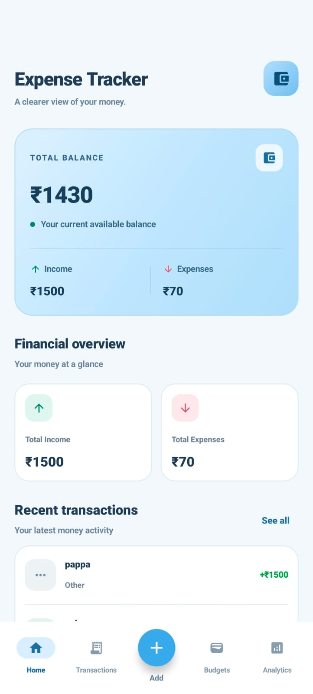
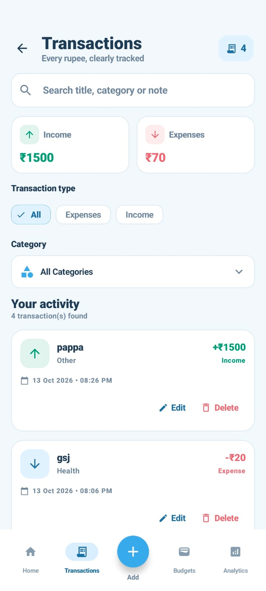
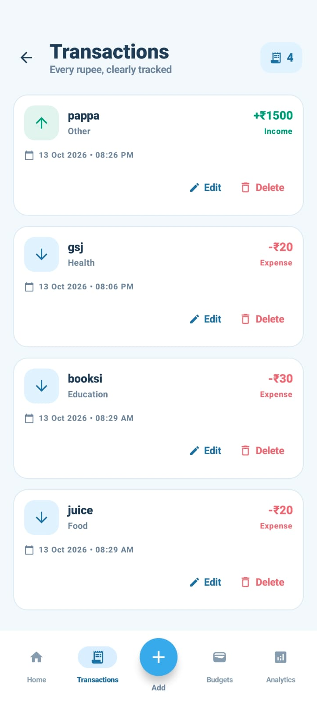
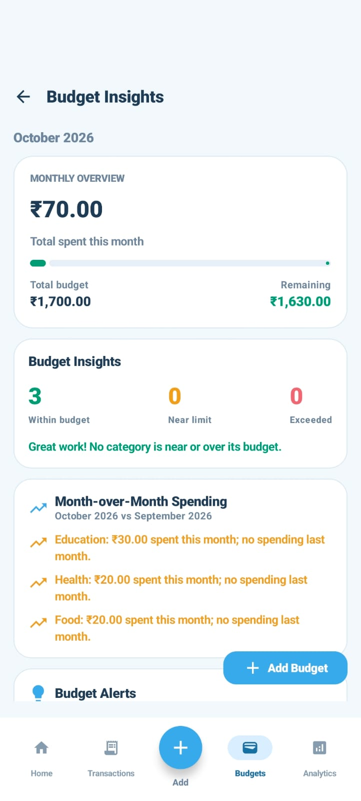

# 💙 Expense Tracker

A modern Android application built with **Kotlin, Jetpack Compose, and Room Database** to simplify personal finance management. Track income and expenses, manage monthly category budgets, and explore spending patterns through a clean, intuitive interface.

<p align="center">
  <strong>Track smarter. Spend better. Stay in control.</strong>
</p>

<p align="center">
  A personal finance app featuring a minimal baby-blue and white UI.
</p>

---

## 📱 Screenshots

<p align="center">
  
  &nbsp;
  
  &nbsp;
  
</p>

<p align="center">
  
  &nbsp;
  
</p>

---

## ✨ Features

### 💰 Dashboard
- View your current balance.
- Track total income and expenses.
- Access essential financial summaries from one place.

### 🧾 Transaction Management
- Add income and expense transactions.
- Record transaction titles, amounts, categories, dates, and optional notes.
- View transaction history.
- Search transactions by title, category, or note.
- Filter transactions by type and category.
- Edit and delete transactions.

### 📊 Analytics
- Review expense summaries and spending patterns.
- Explore expense breakdowns by category.
- Understand where your money is going.

### 🎯 Budget Management
- Create budgets for individual expense categories.
- Set budgets for specific months and years.
- Edit and delete existing budgets.
- Review category budgets to help manage spending.

### 🎨 User Experience
- Clean baby-blue and white theme.
- Custom launcher icon.
- Modern Jetpack Compose interface.
- Navigation between the main application screens.

---

## 🛠️ Tech Stack

| Technology | Usage |
|---|---|
| Kotlin | Primary programming language |
| Jetpack Compose | Declarative Android UI |
| Material 3 | UI components and styling |
| Room Database | Local data persistence |
| Kotlin Coroutines | Asynchronous operations |
| Kotlin Flow / StateFlow | Reactive data observation |
| ViewModel | UI state and application logic |
| Navigation Compose | Screen navigation |
| KSP | Room code generation |
| Gradle | Build and dependency management |

---

## 🏗️ Architecture

The application separates UI components, application logic, and database operations to keep the code organized and maintainable.

```text
Expense-Tracker-app/
├── app/
│   └── src/main/
│       ├── java/com/example/expensetracker/
│       │   ├── data/
│       │   │   ├── Category.kt
│       │   │   ├── local/
│       │   │   │   ├── ExpenseEntity.kt
│       │   │   │   ├── ExpenseDao.kt
│       │   │   │   ├── ExpenseDatabase.kt
│       │   │   │   ├── BudgetEntity.kt
│       │   │   │   └── BudgetDao.kt
│       │   │   └── repository/
│       │   │       ├── ExpenseRepository.kt
│       │   │       └── BudgetRepository.kt
│       │   ├── ui/
│       │   │   └── navigation/
│       │   └── viewmodel/
│       │       ├── ExpenseViewModel.kt
│       │       └── BudgetViewModel.kt
│       └── res/
│           └── mipmap-*/
├── screenshots/
│   ├── dashboard.jpeg
│   ├── add-transaction.jpeg
│   ├── transaction-history.jpeg
│   ├── analytics.jpeg
│   └── budget.jpeg
└── README.md
```

*This is a high-level overview of the project structure. Your actual folders and filenames may differ.*

### Architecture Overview

- **UI layer:** Compose screens render data and respond to user interactions.
- **ViewModel layer:** Exposes observable UI state and coordinates application operations.
- **Repository layer:** Separates data access from UI-facing application logic.
- **Data layer:** Room entities, DAOs, and the database manage local transaction and budget storage.

---

## 🚀 Getting Started

### Prerequisites

- Android Studio
- Android SDK
- A JDK compatible with the project's Gradle configuration
- Git

### 1. Clone the repository

```bash
git clone https://github.com/bindu-yogesh/Expense-Tracker-app.git
```

### 2. Open the project

1. Open Android Studio.
2. Select **Open**.
3. Choose the cloned `Expense-Tracker-app` directory.
4. Allow Gradle to sync and download the required dependencies.

### 3. Run the application

1. Connect an Android device with USB debugging enabled, or start an Android emulator.
2. Select the `app` run configuration.
3. Click **Run**.

The configured minimum Android SDK is **26 (Android 8.0)**.

### 4. Build a debug APK

On Windows:

```powershell
.\gradlew.bat assembleDebug
```

On macOS or Linux:

```bash
./gradlew assembleDebug
```

After a successful build, the debug APK is typically located at:

```text
app/build/outputs/apk/debug/app-debug.apk
```

---

## 💾 Data Storage

The application uses **Room Database** for local persistence.

- Expense and income transactions are stored locally.
- Category budgets are stored locally.
- Database migrations are configured for supported schema changes.

The application documentation does not claim cloud synchronization or online account access.

---

## 🗺️ Future Improvements

Potential enhancements for future versions:

- [ ] Export transactions to CSV or PDF.
- [ ] Add recurring transactions.
- [ ] Introduce budget alerts and spending-limit notifications.
- [ ] Add backup and restore functionality.
- [ ] Enhance analytics visualizations.
- [ ] Add unit tests and UI tests.

---

## 🎓 Key Learnings

Building this project provided hands-on experience with:

- Native Android development using Kotlin.
- Creating declarative interfaces with Jetpack Compose.
- Managing observable UI state with ViewModel and StateFlow.
- Implementing local persistence with Room.
- Structuring application logic using repositories and DAOs.
- Implementing CRUD operations for transactions and budgets.
- Adding search, filtering, and screen navigation.
- Maintaining a consistent application theme.

---

## 👩‍💻 Author

**Bindu Yogesh**

Computer Science and Engineering Student | Android Development

- GitHub: [@bindu-yogesh](https://github.com/bindu-yogesh)
- Repository: [Expense-Tracker-app](https://github.com/bindu-yogesh/Expense-Tracker-app)

---

## 📄 License

No open-source license has been added yet. Until a license is chosen and included in the repository, reuse and redistribution are not explicitly granted.

---

<p align="center">
  <strong>Built with Kotlin 💙 and a passion for Android development.</strong>
</p>